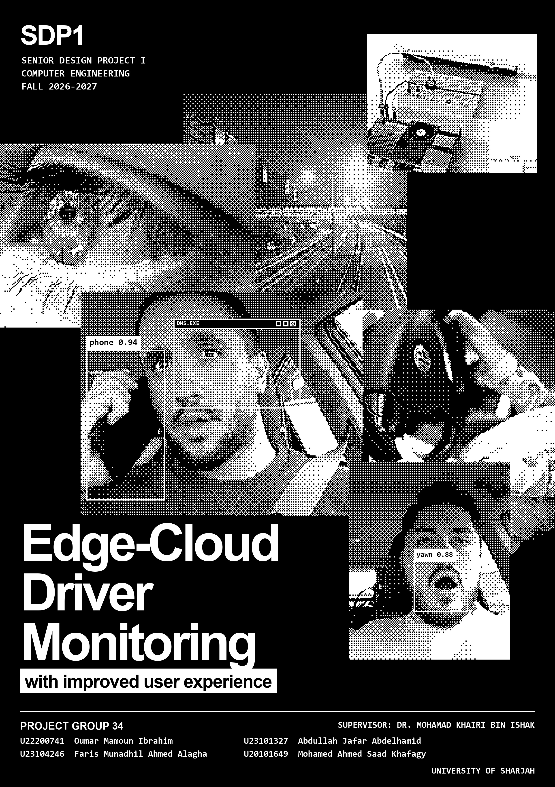
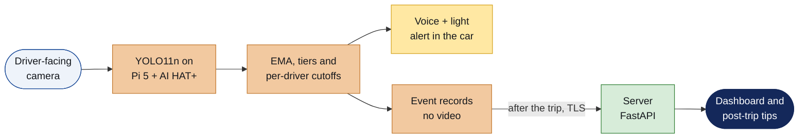
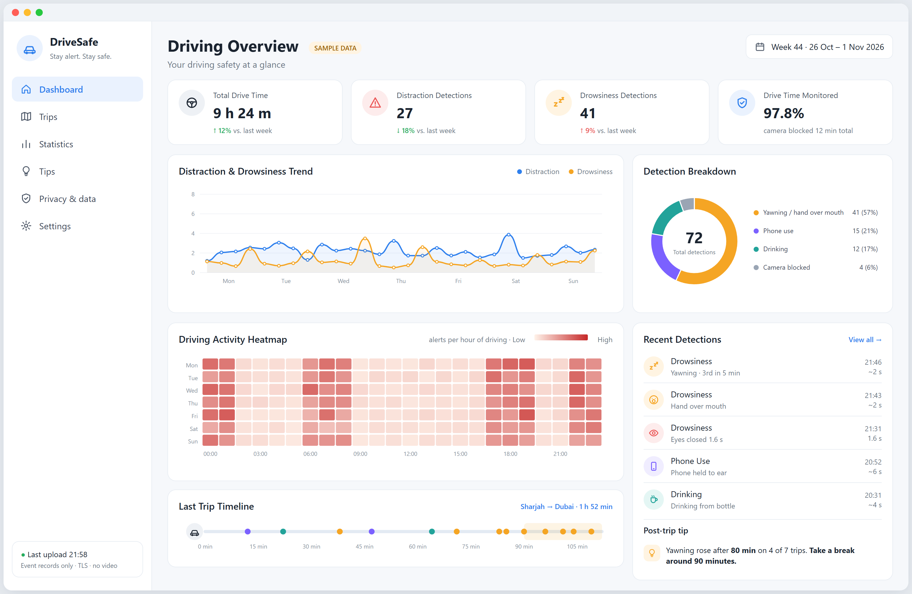
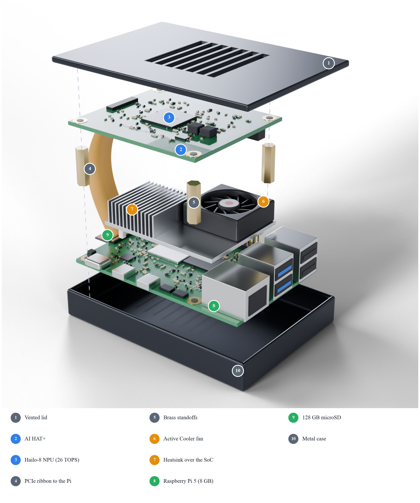
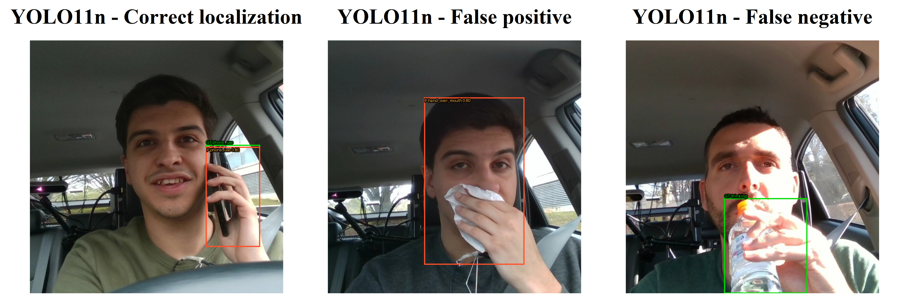
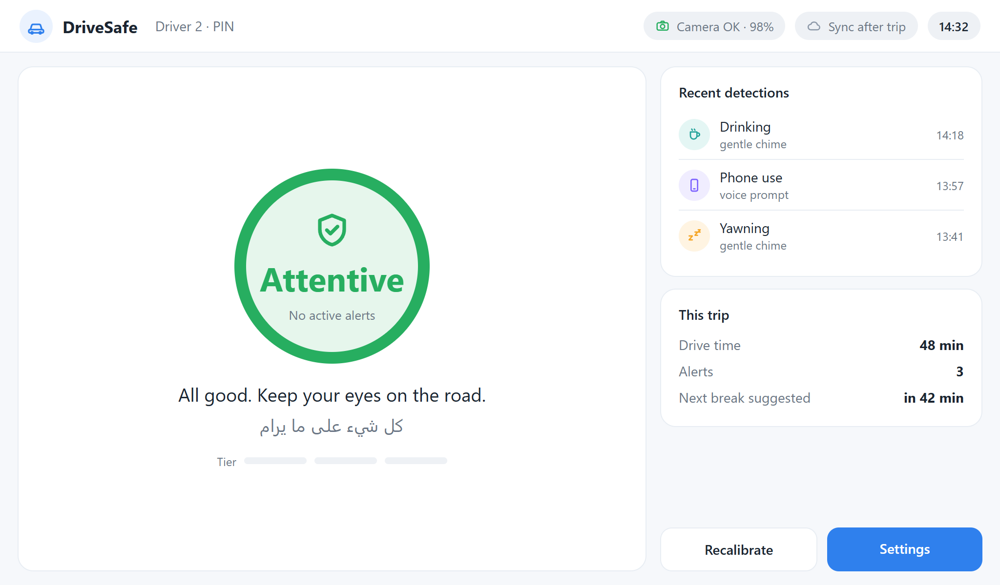
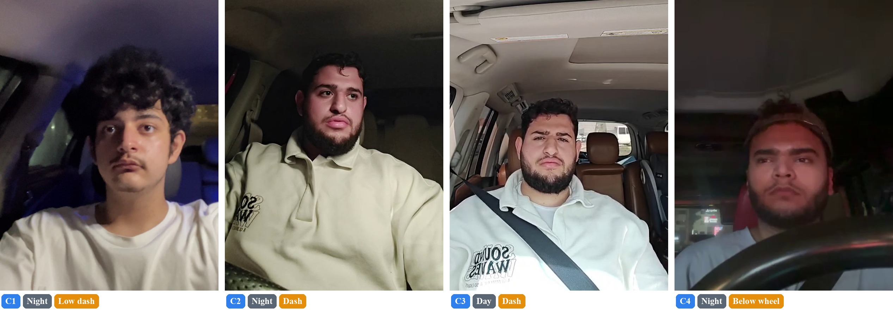

<h1 align="center">DriveSafe</h1>
<p align="center"><b>Edge-Cloud Driver Monitoring with Improved User Experience</b><br>
A camera watches the driver, the Pi warns only when the cue is real. All video stays in the car.</p>

<p align="center">
<a href="report/SDP1_Report_Group34_v12.pdf"></a>
</p>

<p align="center">


</p>

<p align="center"></p>

## How it works



YOLO11n finds **yawning, hand over mouth, drinking and phone use**. The eye module adds eye closure, and a blind check catches a covered camera.

## The system

<table>
<tr>
<td width="62%"></td>
<td width="38%"></td>
</tr>
<tr>
<td><b>Web dashboard</b> (<code>dashboard/</code>, <code>server/</code>): drive time, detections per week, hour-of-day heatmap,
last trip timeline and a post-trip tip. Shown with sample data.</td>
<td><b>Edge unit</b> (<code>edge/</code>): Raspberry Pi 5 (8 GB), AI HAT+ (Hailo-8, 26 TOPS), active cooler, metal case.</td>
</tr>
</table>

## Results at a glance

| Question | Answer |
|---|---|
| What is specified? | **26** testable requirements; **5** whole-system alternatives compared on weighted criteria |
| Which detector? | **YOLO11n** leads nano detectors under subject-disjoint testing |
| Why the AI HAT+? | The Pi 5 CPU alone reaches only about **7 FPS**; target is **25 to 40 FPS**, latency under **100 ms** |
| Do hard negatives help? | **40 %** hard-mined negatives cut false positives by **71 %** |
| Can one cutoff fit everyone? | No. Cutoffs tuned on some drivers do not hold for others, so each driver is calibrated |
| Does it work end to end? | All **194** automated checks pass on a PC. A held-out driver replay ran from video to the dashboard over TLS: **4 of 4** phone cues, **2 of 4** drinking cues, no detector false alerts |
| Real cars? | **4** pilot sessions with three of the authors, by day and by night |
| Left for SDP 2 | On the Pi: per-class recall ≥ **0.90**, fewer than **10** false alarms per hour |

<table>
<tr>
<td width="50%"></td>
<td width="50%"></td>
</tr>
<tr>
<td><b>YOLO11n on held-out drivers.</b></td>
<td><b>In-car screen</b> (<code>edge/tablet_ui.py</code>). Dark and calibration views are in the report.</td>
</tr>
</table>



## Install and run

**On a laptop** (replay of a held-out DMD driver):

```bash
git clone https://github.com/IamOumarIbrahim/Senior-design-project.git
cd Senior-design-project
pip install -r requirements.txt

cd tests && python make_replay.py                         # needs DMS_RGB_DIR (DMD frames)
cd ../edge && python main.py replay ../data/replay_subject_05.mp4
```

The light bar packages only install on the Pi, a laptop skips them. The replay has no sound and no display.
Events go in `data/events.db`. DMD has its own licence, so the frames are not in this repo.
With a GPU set `DMS_DEVICE=0`, but not with mediapipe on Windows: the two together crash CUDA.

**Server and dashboard:**

```bash
cd dashboard && npm install && npm run build
cd ../server && pip install -r requirements.txt
python add_device.py pi5-group34
python seed_demo.py demo demo1234
uvicorn app:app --port 8000                               # open http://127.0.0.1:8000
```

Log in with the demo account. Those trips are made up and the page marks them SAMPLE DATA.
A real driver gets an account with `python set_password.py driver_id name`.
Without `DATABASE_URL` it uses SQLite; `docker compose up` in `server/` runs it with Postgres.

**On the Pi:** see `deploy/` for setup, the service and the voice file generator.

## Repository map

| Path | Contents |
|---|---|
| `edge/` | Everything that runs on the Pi, start with `main.py` |
| `server/` | Upload API, database and post-trip tips (FastAPI) |
| `dashboard/` | Web dashboard (React) |
| `dataset/` | Recording, frames, folds, label checks, hard negatives |
| `training/` | Training, pruning, export, Pi benchmark, Hailo compile |
| `tests/` | One script for each group of tests from Chapter 5 |
| `deploy/` | Pi setup, service and voice file generator |
| `sounds/` `voice/` `models/` | Alert sounds, English and Arabic voice, model weights |
| `report/` | SDP1 report (v12): LaTeX source, figures, figure scripts, PDF |

## Build the report

Needs `pdflatex`, `lualatex` (Arabic abstract), `bibtex` and `makeglossaries`.
On Windows double-click `report/build_clean.bat`, otherwise run `report/build.sh`.
Figures are drawn by the scripts in `report/figsrc/` (Python, Blender, Mermaid).

## Tests

```bash
cd tests
python run_all.py
```

Hardware tests like the 240 fps flash video, the relay power cut and the user trials are done on the bench in SDP 2.

## C++ part

The camera blind check is in C++ because it runs on every frame. It takes 0.32 ms against about 3.0 ms with OpenCV on the PC, and it gave the same brightness, sharpness and decision on all 15,723 DMD frames. The rest stays in Python because the heavy work already runs inside OpenCV, MediaPipe, SQLite or the NPU. EMA and the decision logic take about 2 microseconds a frame.

```bash
bash edge/native/build.sh
```

Build it on the machine that will use it. Without the library `preprocessor.py` uses OpenCV and gives the same answer. The Pi time is not measured yet.

## Features

| Spec | Where | State |
| --- | --- | --- |
| FS-01 Pi 5 deployment | `edge/main.py`, `deploy/` | written, needs the Pi |
| FS-02 camera | `edge/frame_grabber.py` | tested on video files |
| FS-03 detector | `edge/detector.py`, `training/train.py` | runs with the DMD model, needs our data |
| FS-04 EMA | `edge/ema_filter.py` | tested, T-04 |
| FS-05 light and voice | `edge/alert_manager.py` | logic tested, needs the bar and speaker |
| FS-06 cool-down | `edge/decision_engine.py` | tested, T-06 |
| FS-07 mirror checks | by design | needs T-07 with people |
| FS-08 logging | `edge/event_logger.py` | tested |
| FS-09 on-device video | `edge/uploader.py` | tested, only event fields are sent |
| FS-10 dataset | `dataset/` | tools ready, recording not done |
| FS-11 compression | `training/prune.py`, `export_models.py`, `compile_hailo.sh` | pruning, fine tune, ONNX and NCNN ran, Hailo needs the toolchain |
| FS-12 hard negatives | `dataset/mine_hard_negatives.py` | tool ready, needs our data |
| FS-13 baseline clips | `dataset/record_session.py` | written, needs the camera |
| FS-14 class alerts | `edge/alert_manager.py` | tested |
| FS-15 tiers | `edge/decision_engine.py` | tested, T-15 |
| FS-16 explained alerts | `edge/messages.py`, `voice/` | tested, T-16 |
| FS-17 blind check | `edge/preprocessor.py` | tested, T-17, values need tuning on the C922 |
| FS-18 crop tracking | `edge/crop_tracker.py` | tested on a real face, off until it beats the fixed crop |
| FS-19 calibration | `edge/calibrator.py` | tested, T-19 |
| FS-20 eye closure | `edge/eye_module.py` | tested on signals and DMD footage, still above the target, see below |
| FS-21 power-cut logging | `edge/event_logger.py` | passed 50 process kills, needs the relay test |
| FS-22 dashboard and sync | `edge/uploader.py`, `server/`, `dashboard/` | tested over real TLS on SQLite |
| FS-23 tips | `server/tips.py` | tested |
| FS-24 tablet | `edge/tablet_ui.py`, `edge/web/` | screens checked, needs the 7 inch display |
| FS-25 pre-trip check | `edge/tablet_ui.py`, `edge/trip_assistant.py` | tested |
| FS-26 rest stops | `edge/trip_assistant.py` | tested with the saved list |

## Known problem

The eye alarm is better but not finished. The report rule (EAR below 75% of open) fired on half open eyes and on looking down. It now needs EAR below 50% of open and the face model blink score above 0.50, and if the head is more than 8 degrees below the rest pitch it waits 3 s instead of 1.5 s. Head down time is left out of PERCLOS.

Eye alarms per hour on the DMD footage, 14 alert drivers, tuned on subjects 1 to 9 and checked on 10 to 14:

| Rule | Subjects 1-9 | Subjects 10-14 |
|---|---|---|
| Report rule | 97.1 | 120.3 |
| New rule | 22.7 | 20.7 |
| New rule, counting only runs proven over 2 s | 7.4 | 9.7 |

The real number sits between the last two rows because the footage is only 1 fps. Both are above the 3 per hour target. What is left is mostly long looks at the lap and eyes shut during a yawn. A closed eye and a downward look can look the same in one frame, so this needs real closures recorded with the C922 at full frame rate before the thresholds can be trusted. How many true closures the new rule misses is not measured, no labelled closed eye data exists yet.

## Things that differ from the report

- Cool-down starts when the cue ends and not at the first alert, or the tiers could never happen. This follows the state diagram and not Appendix A.
- The event table has one more column, `escalated`. Each tier gets its own row for T-15, and the dashboard only counts the first row of a cue.
- Muted cues in the cool-down are logged with tier 0, this is what T-06 asks for.
- Messages add the count or the length so they pass T-16.
- The tip about phone use at speed needs vehicle data we dont have, so it counts trips instead.
- The dashboard has its own password. The PIN stays in the car.
- The light bar has one MOSFET so it can only flash. The colours in Table 4.15 show on the display only.
- Rest stops use the phone location, and the browser only gives that on HTTPS, so the Pi needs a certificate for it.

## Team

Senior Design Project, Group 34, Computer Engineering, University of Sharjah, Fall 2026–2027.
Supervisor: **Dr. Mohamad Khairi Bin Ishak**.

| Student | ID |
|---|---|
| Oumar Mamoun Ibrahim | U22200741 |
| Abdullah Jafar Abdelhamid | U23101327 |
| Faris Munadhil Ahmed Alagha | U23104246 |
| Mohamed Ahmed Saad Khafagy | U20101649 |
